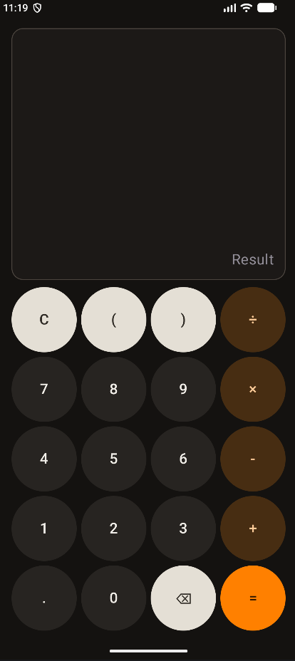
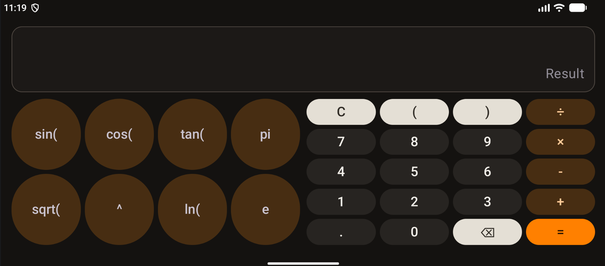
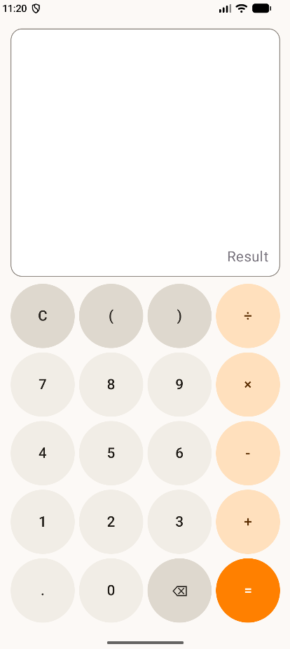
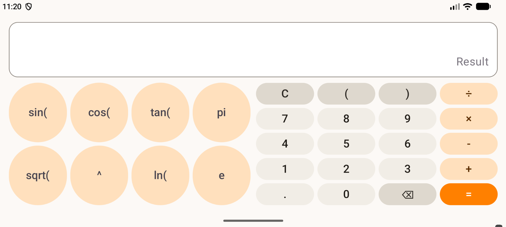

# Kalkulator Android (Jetpack Compose)

Projekt nowoczesnego, responsywnego kalkulatora stworzony w środowisku **Android Studio (Kotlin + Jetpack Compose)** w oparciu o wytyczne projektowe **Material Design 3**.

Aplikacja powstała w ramach przedmiotu **Programowanie Systemów Mobilnych (Konspekt 4: Część 1)**.

---

## 📱 Zrzuty ekranu

### Tryb ciemny (Dark Mode)
|                            Orientacja pionowa (Portrait)                             |                             Orientacja pozioma (Landscape)                             |
|:------------------------------------------------------------------------------------:|:--------------------------------------------------------------------------------------:|
|  |  |

### Tryb jasny (Light Mode)
|                             Orientacja pionowa (Portrait)                              |                              Orientacja pozioma (Landscape)                              |
|:--------------------------------------------------------------------------------------:|:----------------------------------------------------------------------------------------:|
|  |  |

---

## ✨ Kluczowe cechy projektu

1. **Responsywność i adaptacyjny układ (Adaptive Layout):**
   - **Tryb pionowy:** Standardowy układ 4 kolumn i 5 wierszy (podstawowe działania arytmetyczne, nawiasy, czyszczenie i kasowanie).
   - **Tryb poziomy:** Dodatkowy blok funkcji naukowych (`sin(`, `cos(`, `tan(`, `pi`, `sqrt(`, `^`, `ln(`, `e`) pojawia się po lewej stronie, bez duplikowania kodu bloku podstawowego.
   - Płynne skalowanie elementów oparte na proporcjach wag (`Modifier.weight`) oraz elastycznych wymiarach – brak stałych wartości w pikselach czy sztywnych `dp` dla rozmiarów przycisków.

2. **Obsługa długich wyrażeń (Overflow Handling):**
   - Pole wprowadzania działania (`expression`) wyposażone w poziome przewijanie (`Modifier.horizontalScroll`).
   - Automatyczne dociąganie widoku (`LaunchedEffect` + `animateScrollTo`) do ostatnio wprowadzonego znaku, gwarantujące czytelność bez rozpychania karty.

3. **Autorska paleta barw (Material 3):**
   - Świadomie zaprojektowany schemat kolorów oparty na wyrazistym kolorze wiodącym **`#FF8000`**.
   - Wyraźna hierarchia wizualna dla poszczególnych ról:
     - **Cyfry:** stonowane, ciemnografitowe / jasnopiaskowe tło.
     - **Operatory (`+`, `-`, `×`, `÷`):** ciepły, ciemnobursztynowy akcent.
     - **Akcje funkcyjne (`C`, `⌫`, nawiasy):** kontrastowa kość słoniowa.
     - **Równa się (`=`):** żywy pomarańcz `#FF8000`.
   - Pełna zgodność ze standardem dostępności **WCAG 2.2** (kontrast tekstu do tła $> 4.5:1$).
   - Wyłączony `dynamicColor` w celu zachowania spójności motywu na urządzeniach z systemem Android 12+.

4. **Architektura kodu:**
   - Deklaratywny opis przycisków za pomocą struktur danych (`CalcButton`, `ButtonCategory`), minimalizujący powtórzenia kodu.
   - Jednolity komponent `Keypad` reużywany dla klawiatury standardowej i naukowej.
   - Zachowanie stanu wprowadzanego wyrażenia przy rekonfiguracji ekranu (`rememberSaveable`).
   - Inteligentne usuwanie wieloznakowych prefiksów funkcji naukowych przyciskiem `⌫`.

---

## 📝 Odpowiedzi do sprawozdania (Konspekt 4)

### 1. Dlaczego przycisk $\pi$ wpisuje nazwę stałej, a nie przybliżenie liczbowe `3.14159`?
> Wpisanie wartości dziesiętnej `3.14159` powoduje natychmiastową utratę precyzji w obliczeniach zmiennoprzecinkowych z powodu akumulacji błędu zaokrąglenia. Zapisanie stałej w postaci symbolicznej `pi` umożliwia przyszłemu silnikowi obliczeniowemu (Część 2) podstawienie pełnej precyzji maszynowej podwójnej precyzji `Math.PI` (`Double`) lub zastosowanie uproszczeń algebraicznych (np. $\sin(\pi) = 0$ zamiast wyniku rzędu $\approx 10^{-6}$).

### 2. Uzasadnienie wyboru koloru bazowego
> Jako kolor bazowy wybrano wyrazisty odcień pomarańczowego (**`#FF8000`**), który pełni rolę kluczowego akcentu dla przycisku obliczenia wyniku (`=`). Pozostałym elementom przypisano stonowane, ciepłe barwy bursztynu i grafitu, co pozwoliło uzyskać czytelną hierarchię funkcji kalkulatora oraz wysoki kontrast czytelności tekstu (spełniający wytyczne WCAG 2.2) zarówno w motywie jasnym, jak i ciemnym.

---

## 🛠️ Technologie
- **Język:** Kotlin
- **UI Toolkit:** Jetpack Compose
- **Design System:** Material Design 3 (M3)
- **Min SDK:** API 24+
- **Target SDK:** API 37