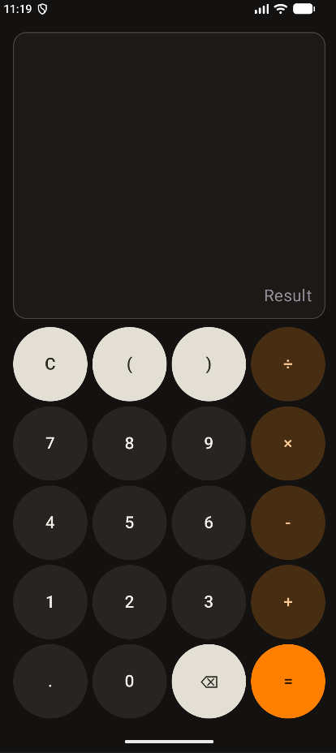
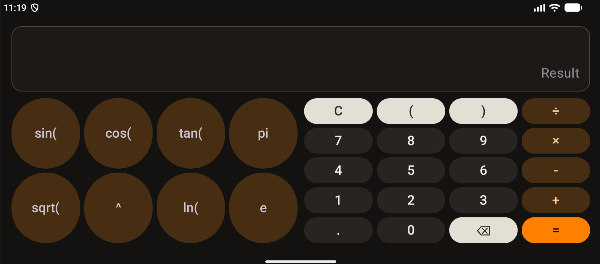
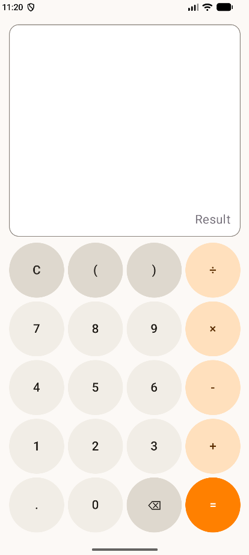
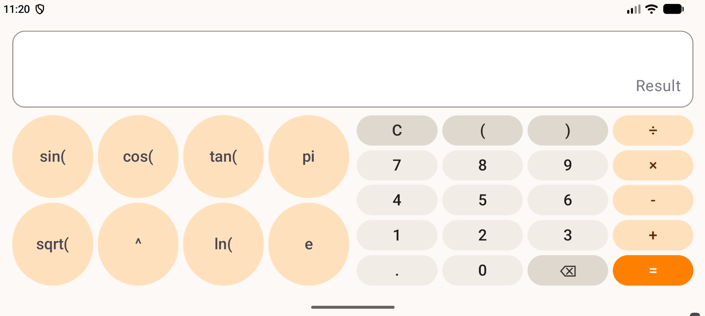

# Kalkulator Android (Jetpack Compose)

Projekt nowoczesnego, responsywnego kalkulatora stworzony w środowisku **Android Studio (Kotlin + Jetpack Compose)** w oparciu o wytyczne projektowe **Material Design 3**.

Aplikacja powstała w ramach przedmiotu **Programowanie Systemów Mobilnych (Konspekt 4: Część 1)**.

---

## Zrzuty ekranu

### Tryb ciemny (Dark Mode)
|                            Orientacja pionowa (Portrait)                             |                             Orientacja pozioma (Landscape)                             |
|:------------------------------------------------------------------------------------:|:--------------------------------------------------------------------------------------:|
|  |  |

### Tryb jasny (Light Mode)
|                             Orientacja pionowa (Portrait)                              |                              Orientacja pozioma (Landscape)                              |
|:--------------------------------------------------------------------------------------:|:----------------------------------------------------------------------------------------:|
|  |  |

---

## Kluczowe cechy projektu

1. **Responsywność i adaptacyjny układ (Adaptive Layout):**
   - **Tryb pionowy:** Standardowy układ 4 kolumn i 5 wierszy (podstawowe działania arytmetyczne, nawiasy, czyszczenie i kasowanie).
   - **Tryb poziomy:** Dodatkowy blok funkcji naukowych (`sin(`, `cos(`, `tan(`, `pi`, `sqrt(`, `^`, `ln(`, `e`) pojawia się po lewej stronie, bez duplikowania kodu bloku podstawowego.
   - Płynne skalowanie elementów oparte na proporcjach wag (`Modifier.weight`) oraz elastycznych wymiarach – brak stałych wartości w pikselach czy sztywnych `dp` dla rozmiarów przycisków.

2. **Obsługa długich wyrażeń (Overflow Handling):**
   - Pole wprowadzania działania (`expression`) wyposażone w poziome przewijanie (`Modifier.horizontalScroll`).
   - Automatyczne dociąganie widoku (`LaunchedEffect` + `animateScrollTo`) do ostatnio wprowadzonego znaku, gwarantujące czytelność bez rozpychania karty.

3. **Autorska paleta barw (Material 3):**
   - Świadomie zaprojektowany schemat kolorów oparty na wyrazistym kolorze wiodącym **`#FF8000`**.
   - Wyraźna hierarchia wizualna dla poszczególnych ról:
     - **Cyfry:** stonowane, ciemnografitowe / jasnopiaskowe tło.
     - **Operatory (`+`, `-`, `×`, `÷`):** ciepły, ciemnobursztynowy akcent.
     - **Akcje funkcyjne (`C`, `⌫`, nawiasy):** kontrastowa kość słoniowa.
     - **Równa się (`=`):** żywy pomarańcz `#FF8000`.
   - Pełna zgodność ze standardem dostępności **WCAG 2.2** (kontrast tekstu do tła $> 4.5:1$).
   - Wyłączony `dynamicColor` w celu zachowania spójności motywu na urządzeniach z systemem Android 12+.

4. **Architektura kodu:**
   - Deklaratywny opis przycisków za pomocą struktur danych (`CalcButton`, `ButtonCategory`), minimalizujący powtórzenia kodu.
   - Jednolity komponent `Keypad` reużywany dla klawiatury standardowej i naukowej.
   - Zachowanie stanu wprowadzanego wyrażenia przy rekonfiguracji ekranu (`rememberSaveable`).
   - Inteligentne usuwanie wieloznakowych prefiksów funkcji naukowych przyciskiem `⌫`.

---

## Odpowiedzi do sprawozdania (Konspekt 4)

### 1. Dlaczego przycisk $\pi$ wpisuje nazwę stałej, a nie przybliżenie liczbowe `3.14159`?
> Wpisanie wartości dziesiętnej `3.14159` powoduje natychmiastową utratę precyzji w obliczeniach zmiennoprzecinkowych z powodu akumulacji błędu zaokrąglenia. Zapisanie stałej w postaci symbolicznej `pi` umożliwia przyszłemu silnikowi obliczeniowemu (Część 2) podstawienie pełnej precyzji maszynowej podwójnej precyzji `Math.PI` (`Double`) lub zastosowanie uproszczeń algebraicznych (np. $\sin(\pi) = 0$ zamiast wyniku rzędu $\approx 10^{-6}$).

### 2. Uzasadnienie wyboru koloru bazowego
> Jako kolor bazowy wybrano wyrazisty odcień pomarańczowego (**`#FF8000`**), który pełni rolę kluczowego akcentu dla przycisku obliczenia wyniku (`=`). Pozostałym elementom przypisano stonowane, ciepłe barwy bursztynu i grafitu, co pozwoliło uzyskać czytelną hierarchię funkcji kalkulatora oraz wysoki kontrast czytelności tekstu (spełniający wytyczne WCAG 2.2) zarówno w motywie jasnym, jak i ciemnym.

---

## Część 2 (Konspekt 5) — Logika, Stan, Testy i Dopracowanie Szczegółów

Rozszerzenie projektu w ramach drugiego etapu obejmuje pełną obsługę obliczeń wyrażeń matematycznych, zachowanie stanu aplikacji przy rekonfiguracji, zestaw testów jednostkowych oraz dopracowanie warstwy wizualnej i językowej.

### 1. Obliczanie wyrażeń i integracja z biblioteką mXparser
- Dołączono bibliotekę **`org.mariuszgromada.math:MathParser.org-mXparser:6.1.1`** poprzez Katalog Wersji Gradle (`gradle/libs.versions.toml`).
- Zadeklarowano wymagany niekomercyjny charakter użycia wywołaniem `License.iConfirmNonCommercialUse(...)`.
- Zapewniono wsparcie dla priorytetów operatorów, nawiasów zagnieżdżonych, funkcji naukowych (`sin`, `cos`, `tan`, `sqrt`, `ln`) i stałych (`pi`, `e`).
- Dodano odporność na błędy składniowe (`checkSyntax()`), wyrażenia niedokończone oraz błędy dziedziny (np. `sqrt(-1)` czy `1/0` zwracające komunikat `"Błąd"` bez awarii aplikacji).

### 2. Zachowanie stanu i cykl życia (State Preservation)
- Wyrażenie (`expression`) oraz wynik (`result`) zapamiętywane są z użyciem `rememberSaveable`.
- Dane przetrzymują obrót ekranu oraz zmianę rozmiaru okna w trybie multi-window.
- Nadpisano metodę `onSaveInstanceState(outState: Bundle)` w `MainActivity` rejestrującą zapisywane wartości w dzienniku Androida (`Logcat`).

### 3. Izolacja logiki i testy jednostkowe (Local Unit Tests)
- Logikę obliczeń wydzielono do niezależnej, czystej funkcji `calculateExpression(expression: String): String`, wolnej od zależności od interfejsu i kontekstu Androida (`Android Context`).
- Utworzono kompletny pakiet testów lokalnych JUnit w `CalculatorTest.kt` wykonujących się błyskawicznie bez potrzeby uruchamiania emulatora:
  - **Kolejność działań:** `2+2*2` = `6`
  - **Nawiasy:** `(2+2)*2` = `8`
  - **Dzielenie przez zero:** `1/0` = `Błąd`
  - **Niedokończone wyrażenie:** `2+` = `""`
  - **Niezamknięty nawias:** `((2+2)` = `""`
  - **Stan początkowy:** `""` = `""`
  - **Dziedzina funkcji:** `sqrt(-1)` = `Błąd`
  - **Duże liczby:** `1234567890*1234567890` = `1524157875019052032`
  - **Separator kropkowy:** `2.5+1` = `3,5`
  - **Separator przecinkowy:** `2,5+1` = `3,5`

### 4. Typografia, Ikona i Wielojęzyczność
- **Typografia:** Zintegrowano czcionkę **JetBrains Mono** z Google Fonts (`androidx.compose.ui:ui-text-google-fonts`). Cyfry tabelaryczne o stałej szerokości zapobiegają drganiu tekstu przy wpisywaniu cyfr.
- **Ikona adaptacyjna (Adaptive Icon):** Stworzona na podstawie wektora kalkulatora, przeskalowana do strefy bezpiecznej (Safe Zone 66dp) z jasnym tłem `#F5F0EB` oraz wsparciem dla jednokolorowych ikonek systemowych `ic_launcher_monochrome.xml`.
- **Wielojęzyczność:** Zlokalizowano zasoby aplikacji — plik `values/strings.xml` (angielski: *Calculator*) oraz `values-pl/strings.xml` (polski: *Kalkulator*).

---

## Odpowiedzi do sprawozdania (Konspekt 5)

### 1. Wskazanie co najmniej dwóch sytuacji (poza obrotem ekranu), w których aktywność zostaje zniszczona i odtworzona przez system:
> 1. **Zmiana rozmiaru okna / Tryb wielookienkowy (Multi-window / Split-screen / Freeform windowing):** Zmiana proporcji aplikacji na tabletach, emulatorze lub urządzeniach składanych wywołuje zdarzenie rekonfiguracji ekranu (`Configuration change`), niszcząc i odbudowując instancję `Activity`.
> 2. **Odzyskiwanie pamięci przez system (System-initiated process death):** Gdy aplikacja przechodzi w tło, a system operacyjny potrzebuje pamięci RAM dla innych procesów, proces aktywności może zostać zamknięty. Po powrocie użytkownika system odtwarza aktywność i przywraca zachowany stan z obiektu `Bundle`.
> 3. **Zmiana motywu systemowego (Jasny / Ciemny) lub zmiana języka systemu:** Zmiana globalnych ustawień systemu wymaga ponownego załadowania zasobów graficznych lub językowych, co skutkuje zniszczeniem i ponownym utworzeniem aktywności.

### 2. Na jakiej licencji udostępniona jest użyta biblioteka mXparser?
> Biblioteka **mXparser** objęta jest licencją podwójną (**mXparser Dual License Agreement**). W zastosowaniach niekomercyjnych, dydaktycznych oraz naukowych jest całkowicie bezpłatna, pod warunkiem jawnego potwierdzenia wywołaniem metody `License.iConfirmNonCommercialUse(...)`. Zastosowania komercyjne wymagają wykupienia płatnej licencji komercyjnej.

---

## Technologie
- **Język:** Kotlin
- **UI Toolkit:** Jetpack Compose
- **Design System:** Material Design 3 (M3)
- **Biblioteka matematyczna:** mXparser 6.1.1
- **Typografia:** JetBrains Mono (Google Fonts)
- **Min SDK:** API 24+
- **Target SDK:** API 37
